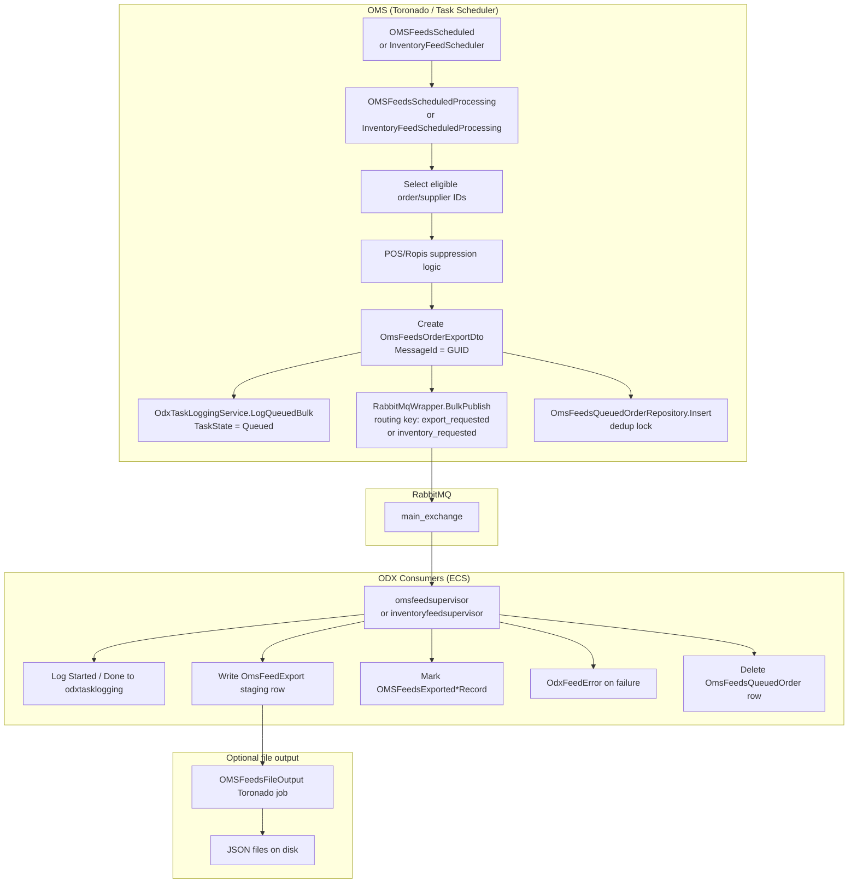

# ODX Feed Pipeline — Technical Reference

Deep dive into what ODX feeds are, how they work end-to-end, and what the monitor can observe.

**Primary repo:** `c:\oms` (OMS producer side)  
**Consumer side:** `omsfeed-service`, `inventoryfeedsupervisor` (ECS — external to OMS repo)

---

## What is ODX?

**ODX (Order Data eXchange)** is Aptos's asynchronous integration layer for exporting OMS data to downstream systems (primarily Sales Audit / POS). In the OMS repo, ODX is the **producer**: it selects eligible records, logs `Queued` to `odxtasklogging`, publishes to RabbitMQ, and locks orders in `omsfeedsqueuedorder`. External ODX consumers process messages, write `Started`/`Done` rows, stage export JSON, and log errors.

There are **three related but distinct** export paths in OMS:

| Pipeline | Entry class | Mode | Output |
|----------|-------------|------|--------|
| Legacy sync | `OMSFeeds` | Synchronous file write | JSON files on disk |
| ODX async | `OMSFeedsScheduled` | RabbitMQ `export_requested` | External consumer → DB staging / files |
| File staging | `OMSFeedsFileOutput` | Reads `OmsFeedExport` table | JSON array files on disk |

The monitor epic focuses on the **ODX async** path and its extensions (ExportOrderItems, Inventory).

---

## End-to-end architecture



---

## Producer flow (OMS repo)

### Scheduler entry

`ShopVisible.Core.ExportClasses/OMSFeedsScheduled.cs`

1. Toronado export job runs with `Export.FileType` = transaction type (e.g. `Fulfillment`, `PaymentReceived`)
2. Maps export config to `OMSFeedScheduledDto`
3. Loops calling `OMSFeedsScheduledProcessing.PerformScheduledOmsTask()`

### Core processing

`ShopVisible.Core.ExportClasses/OMSFeedsScheduledProcessing.cs`

1. `GetOrderIdsByTransactionType()` — queries eligible orders not yet exported and not in queue
2. Transaction-specific suppression (POS offline payments, ROPIS, store returns, etc.)
3. Batches order IDs (max 100 per batch)
4. `MakeMessages()` — creates `OmsFeedsOrderExportDto` with GUID `MessageId` (no dashes)
5. `odxTaskLoggingService.LogQueuedBulk(messages)` — writes `Queued` to `odxtasklogging`
6. `rabbitMqWrapper.BulkPublish("export_requested", messages)`
7. `omsFeedsQueuedOrderRepository.Insert(orderIdsBatch, 0)` — prevents re-queueing

### Message payload

`ShopVisible.Core.ExportClasses/DTOs/OmsFeedsOrderExportDto.cs`

```
MessageId       — GUID (format "N", no dashes)
OrderId         — order reference
TransactionType — e.g. Fulfillment, OrderCreated
Metadata:
  Version, ExportStartDate, ExportEndDate
  LogExtraDetails, SuppressPaymentReceived, TaxInclusivePricing
TaskName        — "OMSFeeds:" + TransactionType  (via IOdxMessage)
ReferenceId     — OrderId
```

### RabbitMQ

`EOM.Wrappers/RabbitMQ/RabbitMqWrapper.cs`

- Exchange: `main_exchange`
- OMS feeds routing key: `export_requested`
- Inventory routing key: `inventory_requested`
- Credentials from AWS Parameter Store via `ConfigurationHelper.GetQueueDetail()`
- Messages: JSON, persistent delivery
- Queue max length: 8196 (per ConnectorSuite MQ pilot runbook)

### Inventory feed (parallel pattern)

`ShopVisible.Core.ExportClasses/InventoryFeed/InventoryFeedScheduledProcessing.cs`

- Same pattern: `LogQueuedBulk` + `BulkPublish("inventory_requested", messages)`
- `TaskName`: typically `"Inventory feed"`
- `ReferenceId`: supplier ID (not order ID)
- Consumer writes to S3 XML (not `omsfeedexport`)

---

## Consumer flow (external — not in OMS repo)

Expected behaviour (from epic + code comments + ConnectorSuite runbooks):

1. Consume `export_requested` or `inventory_requested` message
2. Write `Started` to `odxtasklogging`
3. Build export JSON, write to `omsfeedexport` (order feeds)
4. Mark `OMSFeedsExportedItemRecord` / `AuthRecord` / `CreditRecord` as exported
5. Write `Done` (Success or Error) to `odxtasklogging`
6. On failure: insert `odxfeederror` row
7. Delete `omsfeedsqueuedorder` row for the order

ECS services (from `shared-mq-pilot-pod-omnipod`):

- `omsfeed-service` — order export consumer
- `omsinventoryfeed-service` — inventory consumer

---

## Transaction types (feed types)

`DCEOM.Models/Enum/OMSFeedTransactionType.cs`

| Constant | Typical tracking table |
|----------|------------------------|
| `Fulfillment` | Item + payment auth records |
| `SimpleCredit` | Credit record |
| `DetailCredit` | Credit record |
| `PaymentReceived` | Auth record |
| `Refund` | Credit record |
| `CapturePostFulfillment` | Auth + fulfillment records |
| `Return` | Item record |
| `RefundOnReturn` | Credit record |
| `OrderCreated` | Item record |
| `ItemCancelled` | Item record |
| `PaymentsForMissedOrderAuths` | Auth record |
| `ReadyForPickup` | Item record |
| `ServicesCredit` | Credit record |
| `ServicesCharge` | Additional fee table |

**TaskName in `odxtasklogging`:** `OMSFeeds:{TransactionType}` (e.g. `OMSFeeds:Fulfillment`)

---

## ExportOrderItems (Generate Notifications) — 3-stage path

Separate from standard Toronado OMS feeds:

1. **Service Manager** schedules ExportOrderItems task
2. Task processor publishes per-order `export_requested` messages (ODX `ExportOrderItemsTaskHandler` logs `Queued`)
3. ODX consumer stages row in `omsfeedexport`
4. `OMSFeedsFileOutput` Toronado job reads `omsfeedexport` via `omsfeedexportreader` cursor
5. Writes JSON notification files to configured output path

Monitor Story 8 correlates all three stages on the detail timeline.

---

## POS suppression logic (why orders don't export)

OMS applies transaction-specific filters before queueing. Key ad-hoc queries in `DCEOM.DataAccess/AdHocQueries/OMSFeeds/`:

| Query class | Purpose |
|-------------|---------|
| `OdxGetOffLinePaymentsFromPOSForPayment` | Strip offline POS payments from PaymentReceived |
| `OdxGetOffLinePaymentsFromPOSForFulfillment` | Pre-mark offline POS payments on Fulfillment |
| `OdxGetStoreCreditsFromPOSForDetailedCredit` | Suppress POS credits |
| `OdxGetStoreCreditsFromPOSForRefundOnReturn` | Suppress POS refund credits |
| `ODXGetPosRopisOrdersForOrderCreate` | Suppress ROPIS POS orders from OrderCreated |
| `ODXGetStoreReturnsFromPOSForReturn` | Suppress POS returns |

**Monitor implication:** An order with no `odxtasklogging` rows may have been **suppressed**, not failed. The monitor shows what was queued — not what was filtered out at selection time.

---

## Toronado job configuration fields

From `OMSFeedsScheduled.MapExportToParameters()`:

| Export field | Maps to |
|-------------|---------|
| `FileType` | `TransactionType` |
| `CustomField1` | `Version` (default "1") |
| `CustomField2` | `MaxIterations` (0 = infinite) |
| `CustomField3` | `SuppressPaymentReceived` |
| `CustomField4` | Display name in logs |
| `CustomField10` | `LogExtraDetails` flag |
| `MaxRecords` | Records per iteration (default 100) |
| `OrderExportBuyersRemorseMinutes` | `MinimumOrderAgeMinutes` |
| `ExportStartDate` | Filter start date |

---

## Reconciliation and maintenance

| Mechanism | Purpose |
|-----------|---------|
| SQL reconciliation procs | Use `odxfeederror` + `omsfeedsqueuedorder` to fix stuck orders |
| `EOM-Purge OMSFeedExport` job (DCOMS-11219) | Prevent `omsfeedexport` bloat |
| Daily script (DCOMS-27496 context) | Clears old `omsfeedsqueuedorder` rows — can cause late JSON production |
| Index maintenance (DCOMS-11546, DCOMS-19062, DCOMS-29419) | Query performance |

---

## Key source files

| File | Role |
|------|------|
| `OMSFeedsScheduledProcessing.cs` | ODX order feed producer |
| `InventoryFeedScheduledProcessing.cs` | ODX inventory feed producer |
| `OdxTaskLoggingService.cs` | Writes `Queued` rows |
| `OdxOmsFeedsOrderService.cs` | Order selection + suppression |
| `RabbitMqWrapper.cs` | MQ publish |
| `OMSFeedsFileOutputProcessing.cs` | File output from staging table |
| `DataFeedOrderSelectionRepository.cs` | Eligible order SQL |
| `ToronadoBootStrapper.cs` | DI registration for ODX services |

---

## What the monitor observes vs what it cannot

| Observable via monitor | Not observable (out of scope or no data) |
|------------------------|------------------------------------------|
| `Queued` / `Started` / `Done` per messageid | Orders suppressed before queueing |
| Backlog (Queued without Done) | Live RabbitMQ queue depth |
| `odxfeederror` summaries | Full CloudWatch stack traces |
| `omsfeedsqueuedorder` stuck status | RabbitMQ message body content |
| `omsfeedexport` staging status | S3 file contents (inventory) |
| Export file output stage (where correlatable) | Toronado job configuration UI |
