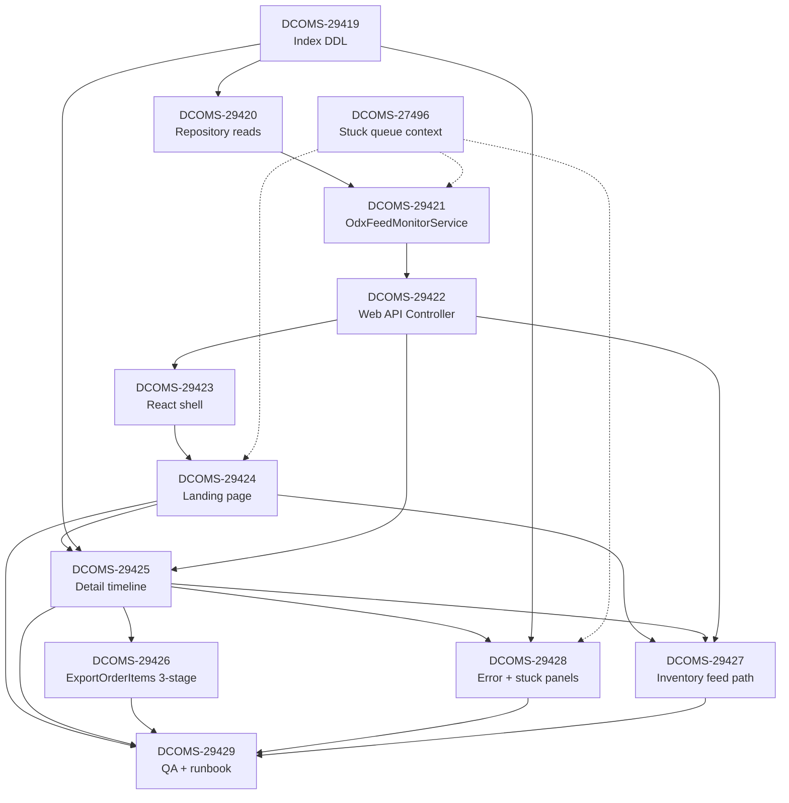

# Ticket Dependency Map — DCOMS-29203

This document maps **what depends on what** across the epic, with emphasis on **DCOMS-29423** (your current story).

---

## Dependency diagram

---

## Per-ticket dependencies

### DCOMS-29419 (Story 1) — Index DDL
- **Depends on:** Nothing
- **Blocks:** Stories 2, 7, 8, 9 (any query by `referenceid` or date on large tables)
- **Status:** Closed
- **Local repo note:** Index SQL scripts not verified in `c:\oms` workspace at doc time

### DCOMS-29420 (Story 2) — Repository + pivot DTO
- **Depends on:** Story 1 (indexes for `GetByReferenceId`, backlog)
- **Blocks:** Story 3
- **Delivers:** `MessagePipelineStatus` DTO, `GetByMessageId`, `GetSummaryByTaskNameAndState`, `GetByReferenceId`, `GetBacklog`
- **Status:** Closed (code not in local workspace)

### DCOMS-29421 (Story 3) — Service layer
- **Depends on:** Stories 1, 2
- **Blocks:** Story 4
- **Delivers:** `IOdxFeedMonitorService`, `GetSummary`, `GetBacklog`, `GetStuckOrders`, `GetRecentErrors`, `GetMessageTimeline`
- **Relates to:** DCOMS-27496 (stuck `omsfeedsqueuedorder`)
- **Status:** Closed (code not in local workspace)

### DCOMS-29422 (Story 4) — Web API
- **Depends on:** Stories 1, 2, 3
- **Blocks:** Stories 5, 6, 7 (axios wiring and real data)
- **Delivers:**
  - `GET /api/OdxFeedMonitor/summary`
  - `GET /api/OdxFeedMonitor/backlog`
  - `GET /api/OdxFeedMonitor/stuckorders`
  - `GET /api/OdxFeedMonitor/errors`
  - `GET /api/OdxFeedMonitor/timeline/{messageid}`
  - `GET /api/OdxFeedMonitor/search`
- **Status:** In Progress
- **Note for Story 5:** Shell can merge **before** API is complete; axios can use stub responses until Story 4 lands

### DCOMS-29423 (Story 5) — React shell ⭐ YOUR STORY
- **Depends on:** Story 4 for full axios wiring (soft dependency — shell can ship with placeholder)
- **Blocks:** Stories 6, 7
- **Delivers:**
  - `backadmin/odxfeedmonitor.aspx` (+ code-behind)
  - `src/app/OdxFeedMonitorApp.js`
  - `src/odxFeedMonitor/` module directory
  - `index.js` mount div registration
  - Backadmin navigation link
  - Placeholder UI until Stories 6–7
- **Can start now:** Yes — mirror Service Manager shell without waiting for API

### DCOMS-29424 (Story 6) — Landing page
- **Depends on:** Stories 4, 5
- **Blocks:** Story 7 (navigation from search results)
- **Also requires:** New permission checkbox under Content; menu tab under Feed Monitoring
- **Assignee:** Aryan Kashyap

### DCOMS-29425 (Story 7) — Detail timeline
- **Depends on:** Stories 4, 5, 6
- **Blocks:** Stories 8, 9

### DCOMS-29426 (Story 8) — ExportOrderItems correlation
- **Depends on:** Stories 1, 4, 7

### DCOMS-29428 (Story 9) — Error + stuck panels
- **Depends on:** Stories 1, 4, 7

### DCOMS-29427 (Story 10) — Inventory feed
- **Depends on:** Stories 1, 4, 6, 7

### DCOMS-29429 (Story 11) — QA + runbook
- **Depends on:** All Stories 1–10

---

## What you can do on DCOMS-29423 without waiting

| Task | Blocked by Story 4? |
|------|---------------------|
| Create `odxfeedmonitor.aspx` shell | No |
| Create `OdxFeedMonitorApp.js` with placeholder | No |
| Register mount div in `index.js` | No |
| Add backadmin menu link | No |
| Create `odxFeedMonitorApi.js` axios module | No (stub endpoints) |
| Wire real API calls | Yes — needs Story 4 |
| Build landing tiles / grid | Yes — that's Story 6 |

---

## Cross-epic dependency: DCOMS-27496

DCOMS-27496 documents production issue: orders stuck in `omsfeedsqueuedorder` with **no** corresponding `odxfeederror` rows. The monitor addresses this visibility gap in:

- **Story 3:** `GetStuckOrders(thresholdHours)`
- **Story 6:** Stuck-order panel on landing page
- **Story 9:** Stuck-order panel on detail view

The monitor is **read-only** — it does not clear stuck rows or fix the root cause.

---

## Suggested parallel work

While Story 4 (API) completes:

1. **Aryan (29423):** Ship ASPX + React shell + nav + permissions scaffolding
2. **Sanika (29422):** Finish controller endpoints
3. **Aryan (29424):** Start landing page layout against mock API stubs once shell merges

---

## Risk: Jira closed vs local code missing

Stories 2 and 3 are **Closed** in Jira but `OdxFeedMonitor*` / `MessagePipelineStatus` were **not found** in `c:\oms` at documentation time.

**Action:** Confirm implementing branch is checked out or merged before assuming repository/service layers exist. Story 5 shell work is independent; Story 6+ will need the API contract from Story 4.
