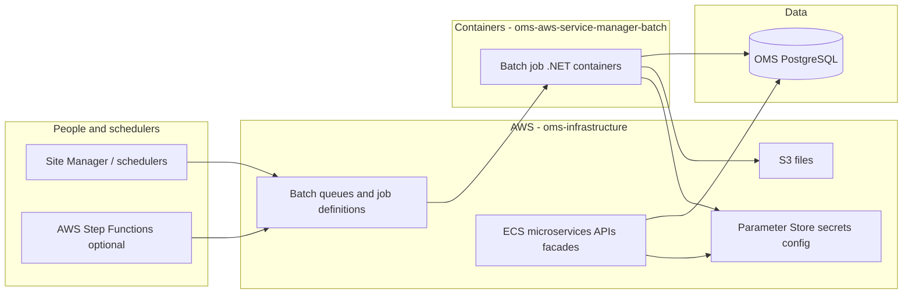

# OMS on AWS — onboarding (start here if you're new)

**Full doc space:** [HOME.md](./HOME.md) — Confluence-style table of contents and role paths.

This page is a **20-minute** introduction. Deep pages are split by domain (`06`–`10`).

---

## What is OMS?

**OMS (Order Management System)** is the software retailers use to **take, change, route, and fulfill customer orders**. Order logic lives in **PostgreSQL** and in shared .NET libraries (**EOM** / **DCEOM**).

On AWS, OMS is **many containers and databases**, not one app:

- **Site Manager** — operator UI (`/backadmin`) → [06-site-manager-shoplogic.md](./06-site-manager-shoplogic.md)  
- **APIs** — facades and core services → [09-facades-core-edge.md](./09-facades-core-edge.md)  
- **Background work** — tasks, feeds, **AWS Batch** → [08-task-engine-feeds.md](./08-task-engine-feeds.md), [01-batch.md](./01-batch.md)  
- **Platform** — VPC, RDS, Harness → [10-platform-data-delivery.md](./10-platform-data-delivery.md)

---

## Five places (not one repo)

| # | Repo | Path | You change it when… |
|---|------|------|---------------------|
| 1 | **oms** | `RepoSuite/oms` | ShopLogic pages, JobManager, SQL scripts, APIs in monorepo |
| 2 | **oms-aws-job-scheduler** | `RepoSuite/oms-aws-job-scheduler` | Scheduler REST API, `oms_batch` schema, EventBridge hooks |
| 3 | **oms-aws-service-manager-batch** | `RepoSuite/oms-aws-service-manager-batch` | Batch worker .NET code & Docker |
| 4 | **oms-infrastructure** | `RepoSuite/oms-infrastructure` | AWS resources, ECS, Batch definitions, SSM |
| 5 | **Product knowledge** | `superdev-hmm/oms/product-knowledge/` | **Docs you are reading** (not production code) |

Deep map: [27-functional-cross-repo-flows.md](./27-functional-cross-repo-flows.md), [FUNCTIONAL-COVERAGE.md](./FUNCTIONAL-COVERAGE.md), [COVERAGE.md](./COVERAGE.md).

---

## The big picture (one diagram)

**Simple sentence:** Schedulers ask AWS Batch to **run a container once**; that container runs .NET code that **reads/writes OMS data** and sometimes **uploads files to S3**. Long-running APIs stay on **ECS**. **Terraform** creates the AWS pieces; application code lives in **oms** and **batch** repos.

---

## Glossary (plain English)

| Term | Meaning |
|------|---------|
| **OMS DB** | PostgreSQL database holding orders, items, suppliers, scheduler metadata, etc. |
| **EOM** | Shared .NET libraries for order/inventory operations (private NuGet). |
| **Service Manager** | Legacy Windows-side scheduler; migrating tasks to **AWS Batch**. |
| **Site Manager** | Admin UI; URLs often under **`/backadmin/`**. |
| **ShopLogic** | Main admin web application project in `RepoSuite/oms`. |
| **minisoft** | ECS service name that hosts Site Manager image on AWS. |
| **ODX** | Older export/integration stack; many flows replaced by Batch. |
| **Toronado** | Export/job-step configuration in OMS DB. |
| **AWS Batch** | Run a container with a command, queue, retries. |
| **Job definition** | Batch template (image, CPU, env) — Terraform stage **B**. |
| **SubmitJob** | API to run one job instance with JSON parameters. |
| **Fargate** | Serverless containers for Batch/ECS. |
| **SSM Parameter Store** | AWS config/secrets (often **names** of connection params). |
| **Harness** | CD tool running `terraform apply` per stack. |
| **Facade** | ECS API for a domain (orders, inventory). |
| **Stage A/B/C/D** | Four Terraform steps for Batch onboarding ([02-terraform.md](./02-terraform.md)). |
| **oms-aws-job-scheduler** | Separate repo — Batch scheduler API on ECS ([13-deployables-catalog.md](./13-deployables-catalog.md)). |

More terms: [14-glossary-extended.md](./14-glossary-extended.md).

---

## What are the five batch jobs? (business view)

| Job | What problem it solves |
|-----|-------------------------|
| **Inventory Feed** | Product inventory files → **S3** |
| **Export Order Items** | Order export files / notes (replaces queue export) |
| **Reset Items for Reroute** | Bulk reset lines for rerouting |
| **Update Item Status** | Bulk status changes |
| **Cancel Items** | Bulk cancel; optional SES email |

Details: [01-batch.md](./01-batch.md).

---

## How a batch run works

1. Trigger — scheduler, Step Function, or manual SubmitJob.  
2. AWS Batch starts container from **batch repo** image.  
3. Container receives **JSON** (argv or env).  
4. DB connection via **SSM** env vars.  
5. Work + **exit code**; logs in CloudWatch.

---

## Who should read what?

| You are… | Read first | Then |
|----------|------------|------|
| **Brand new** | [HOME.md](./HOME.md) → this page | [06](./06-site-manager-shoplogic.md) or [03 QA](./03-qa-environments.md) |
| **Batch developer** | [01-batch.md](./01-batch.md) | [07](./07-batch-scheduler-api-ui.md), [02-terraform.md](./02-terraform.md) |
| **Platform / DevOps** | [02-terraform.md](./02-terraform.md) | [10-platform-data-delivery.md](./10-platform-data-delivery.md) |
| **QA / explorer** | [03-qa-environments.md](./03-qa-environments.md) | [06-site-manager-shoplogic.md](./06-site-manager-shoplogic.md) |
| **Architect** | [05-oms-estate-map.md](./05-oms-estate-map.md) | [04-deep-repo-scan.md](./04-deep-repo-scan.md) |

---

## Common beginner mistakes

1. Confusing **five repos** — editing docs does not deploy code; scheduler API is **not** in the batch repo.  
2. **Terraform-only** or **code-only** changes for Batch (need both).  
3. **Wrong Batch Terraform folder numbers** (`02-` vs `03-` for B/D).  
4. **Export `taskId`** ≠ AWS Batch job id.  
5. **Retrying** on non-retryable exit codes ([01-batch.md](./01-batch.md)).

---

## Next steps

Open [HOME.md](./HOME.md) and follow your role path. For Cursor: skill **`oms-product-knowledge`**.
