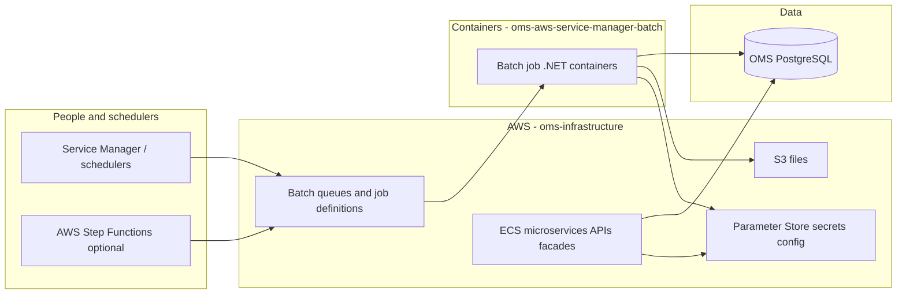

# OMS on AWS — onboarding (start here if you're new)

This guide assumes **no prior OMS experience**. Technical depth lives in [01-batch.md](./01-batch.md) and [02-terraform.md](./02-terraform.md); read those after this page.

---

## What is OMS?

**OMS (Order Management System)** is the software retailers use to **take, change, route, and fulfill customer orders**. Think: order placed online → warehouse picks items → status updates → cancellations → feeds to other systems (e.g. commerce sites, marketplaces).

In Aptos Retail’s world, OMS is not one tiny app. It is a **family of services and databases** that work together. Most day-to-day order logic still lives in a large **PostgreSQL** database (“OMS DB”) and in libraries many teams call **EOM** (order/inventory components).

---

## The big picture (one diagram)

**Simple sentence:** Schedulers ask AWS Batch to **run a container once**; that container runs .NET code that **reads/writes OMS data** and sometimes **uploads files to S3**. Long-running APIs stay on **ECS**. **Terraform** in `oms-infrastructure` creates the AWS pieces; **.NET code** in `oms-aws-service-manager-batch` is what runs *inside* the container.

---

## Two repos — who owns what?

| Question | Answer | Repo |
|----------|--------|------|
| “What happens when inventory is exported?” | Business logic, SQL, XML, S3 upload | **oms-aws-service-manager-batch** |
| “Which Docker image, CPU, retries, logs?” | Job definition, IAM, queues | **oms-infrastructure** |
| “Where is the VPC / database?” | Foundation Terraform | **oms-infrastructure** (`01-infrastructure`) |
| “Where is the order API?” | ECS service stacks | **oms-infrastructure** (`03-application/01-aws-ecs-service/…`) |

If you only remember one thing: **batch repo = program**, **infra repo = where and how it runs on AWS**.

---

## Glossary (plain English)

| Term | Meaning |
|------|---------|
| **OMS DB** | PostgreSQL database holding orders, items, suppliers, scheduler metadata, etc. |
| **EOM** | Shared .NET libraries for order/inventory operations (private NuGet). Batch jobs that *change* orders often call EOM. |
| **Service Manager** | Legacy Windows-side scheduler that used to run .NET “tasks” on a timer. We’re moving those tasks to **AWS Batch**. |
| **ODX** | Older export/integration stack. New batch jobs **replace** many ODX flows (especially RabbitMQ hops). |
| **Toronado** | Configuration/export subsystem; export jobs often get **XML/config** that describes *what* to export. |
| **AWS Batch** | AWS product: “run this container with this command, on this queue, with these retries.” |
| **Job definition** | AWS Batch template: image, CPU, memory, command, env vars, log group. Created by **Terraform stage B**. |
| **SubmitJob** | API call: “run one instance of a job definition now,” with parameters (often a JSON payload). |
| **Fargate** | Serverless containers for Batch/ECS — no EC2 instances to patch yourself. |
| **SSM Parameter Store** | AWS place to store config and secrets (e.g. DB connection string *name*, not always the secret in git). |
| **Harness** | CD tool that runs `terraform plan/apply` per stack folder. |
| **Facade** | ECS API service that fronts OMS for a domain (orders, inventory, etc.). |
| **Stage A/B/C/D** | Four Terraform steps to onboard one scheduled job onto Batch (see [02-terraform.md](./02-terraform.md)). |

---

## What are the five batch jobs? (business view)

| Job | What problem it solves |
|-----|-------------------------|
| **Inventory Feed** | Build and publish **product inventory files** (e.g. for commerce) from OMS supplier data → **S3**. |
| **Export Order Items** | Generate **order export notifications/files** for downstream feeds (replaces old queue-based export). |
| **Reset Items for Reroute** | When routing changes, **reset line items** so they can be re-routed (bulk operational fix). |
| **Update Item Status** | **Bulk status changes** on order lines (e.g. move many items to a new status). |
| **Cancel Items** | **Bulk cancel** line items matching filters; can send email via SES. |

Each job is a **short-lived container**: start → do work → exit with a **number** (exit code). Zero usually means success. Infra uses that number to decide **retry or fail**.

---

## How a run works (no jargon path)

1. **Something triggers a run** — scheduler, Step Function, or manual `submit-job`.
2. **AWS Batch** starts a container from an **image** built from the batch repo.
3. The container receives a **JSON instruction** (what to run, filters, settings). Often passed as the **last command-line argument** or an env var.
4. The program loads **database connection** info (often via SSM + env vars — no password in git).
5. It runs SQL / EOM calls / file generation.
6. It **exits** with a code. **CloudWatch** has JSON logs for support.

---

## Service Manager → Batch migration (why A→C→B→D exists)

Old world: a Windows service ran `ExportOrderItems.exe` on a schedule.

New world needs:

1. **Shared Batch capacity** (queue + compute) for all jobs — **stage A**
2. **Scheduler database rows** so the OMS scheduler UI knows those queues exist — **stage C**
3. **This job’s** image, command, retries, logs — **stage B** (per job)
4. **Scheduler database row** for *this* job definition — **stage D** (per job)

Apply order: **A → C → B → D**. Details: [02-terraform.md](./02-terraform.md).

---

## Who should read what?

| You are… | Read first | Then |
|----------|------------|------|
| **New developer** on batch code | This page → [01-batch.md](./01-batch.md) | Job README under `Jobs/<Name>/` in RepoSuite |
| **New platform / DevOps** | This page → [02-terraform.md](./02-terraform.md) | `config.tfvars.example` for your job’s stage B |
| **Support / on-call** | This page, exit code tables in [01-batch.md](./01-batch.md) | CloudWatch log group from stage B |
| **Architect** | All three product-knowledge files | `docs/ARCHITECTURE.md` in batch repo |

---

## Local paths (this machine)

| Repo | Path |
|------|------|
| Batch (.NET) | `/Users/akashyap/RepoSuite/oms-aws-service-manager-batch` |
| Terraform | `/Users/akashyap/RepoSuite/oms-infrastructure` |

---

## Common beginner mistakes

1. **Editing only the .NET repo** but forgetting **Terraform job definition** (image tag, env, `Ref::` parameter name).
2. **Expecting RabbitMQ** — new inventory/export paths are **in-process**, not queues in the batch repo.
3. **Using the wrong folder number** for Terraform stage B/D (README typos vs real `02-` / `03-` folders).
4. **Confusing “task id”** on Export Order Items with AWS Batch job id — export needs a **scheduler task GUID** from OMS DB.
5. **Retrying forever** on exit codes that mean “config wrong” — only some exit codes are retryable.

---

## Next steps

1. [01-batch.md](./01-batch.md) — jobs, JSON payload, exit codes, Docker, tests.  
2. [02-terraform.md](./02-terraform.md) — folders, SSM, state, ECR wiring.

For Cursor agents: skill **`oms-product-knowledge`** points here first.
