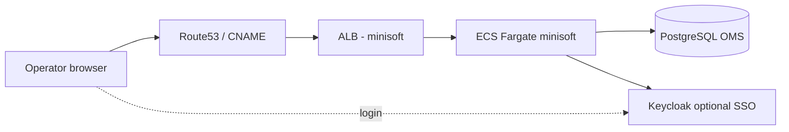

# Site Manager, ShopLogic, and minisoft

**Audience:** New developers, QA, anyone who hears “Site Manager”, “backadmin”, or “ShopLogic” and needs orientation.  
**Prerequisites:** [00-onboarding.md](./00-onboarding.md) (5 min).  
**Related:** [03-qa-environments.md](./03-qa-environments.md), [07-batch-scheduler-api-ui.md](./07-batch-scheduler-api-ui.md), [26-oms-monorepo-complete-reference.md](./26-oms-monorepo-complete-reference.md) (full repo inventory).

---

## What problem this area solves

Retail operators need a **web UI** to manage orders, catalog, users, releases, and configuration. That UI is **Site Manager**. Developers and integrators often work against **ShopLogic** — the ASP.NET site and APIs that host admin pages and server-side logic.

On AWS, the **minisoft** ECS service runs the **container image** that serves this stack. The hostname you open in a browser (e.g. `oms-pod-dev-sm…`) is wired through **Route53**, **ALB**, and **SSM** — not hard-coded in this doc.

---

## Vocabulary

| Term | Meaning |
|------|---------|
| **Site Manager** | Product name for the operations admin experience |
| **backadmin** | URL path prefix for the legacy admin app (`/backadmin/login.aspx`, etc.) |
| **ShopLogic** | `ShopVisible.Core.ShopLogic` — main WebForms / admin site project in `RepoSuite/oms` |
| **minisoft** | ECS service name in Terraform; hosts the Site Manager image |
| **iZenda** | Embedded reporting; infra has `sitemanager_izenda_*` SSM flags |
| **DCEOM.Backadmin.UI** | Supporting UI/library code in the monorepo |

---

## Architecture (logical)

**Plain sentence:** You hit a **public URL** → load balancer → **minisoft container** → reads/writes **OMS database** and related config from **Parameter Store**.

---

## Repository map (`RepoSuite/oms`)

| Path | Role |
|------|------|
| `ShopVisible.Core.ShopLogic/` | Admin site root; `backadmin/` pages |
| `ShopVisible.Core.ShopLogic.AppCode/` | App_code layer |
| `ShopVisible.Core.Shoplogic.Frontend.React/` | Modern React bundles for some admin flows |
| `Shopvisible.Core.Shoplogic.BatchJobManager.Frontend.React/` | Batch Job Manager SPA (see domain 07) |
| `DCEOM.Backadmin.UI/` | Backadmin UI components |
| `EOM.ShopLogicApi/` | ShopLogic-facing API surface |
| `EOM.ShopLogicServices*` | Service layer behind APIs |
| `DCEOM.WebApi/` | Web API including proxies (e.g. Batch scheduler) |
| `DCEOM.DataAccess*` | Database access for EOM/DCEOM |
| `SQLChangeScripts/` | DB migrations for features (nav, settings) |

**Solution files:** `DCEOM.All.sln`, `Solutions/ShopVisible.ShopLogic.sln` — full builds are heavy; use team Jenkins/Harness docs for CI.

---

## Infrastructure map (`RepoSuite/oms-infrastructure`)

| Stack | Path | Purpose |
|-------|------|---------|
| **minisoft ECS** | `03-application/01-aws-ecs-service/04-minisoft` | Task definition, service, ALB, image vars |
| **EFS mount** | `02-efs-fileexplorer`, cluster EFS access point | Shared files under `/minisoft` on container |
| **Site Manager SSM** | `01-infrastructure/01-parameterstore` | `sitemanager_endpoint`, auth mode, strategy flags, `minisoft/endpoint` |
| **DNS** | `03-application/12-core-route53` | CNAME from SSM `sitemanager_endpoint` |
| **Keycloak** | `03-application/01-aws-ecs-service/03-keycloak` | Identity for newer flows |

Harness pipeline stage: **`minisoft_deploy`** in `01-infrastructure/08-core/harness-pipeline-source/oms15-ECS.yaml`  
State key pattern: `{space}/{environment}/applications/ecs-service/minisoft/terraform.tfstate`

---

## How login works (QA mental model)

1. Browser opens **`/backadmin/login.aspx`** on the Site Manager host (see [03-qa-environments.md](./03-qa-environments.md)).
2. Credentials may be **classic forms auth** or routed via **Keycloak** depending on `sitemanager_authentication_mode` in SSM (set per environment in parameter store stage).
3. After login, menus (Commerce, Users, Releases, …) come from **OMS DB** resources/roles.

**Do not commit passwords.** Use `qa-tester/environments.local.md` or team vault.

---

## Modern UI pieces (React)

Some admin features ship as **React** apps built with npm, then **copied into** ShopLogic static folders:

- Example build output: `ShopVisible.Core.ShopLogic/static/batch-job-manager/`  
- Parent page: `backadmin/BatchJobManager.aspx`

This pattern keeps the browser on **same origin** as ShopLogic while using modern front-end tooling.

---

## ODX Feed Monitor (legacy pipeline visibility)

**Path:** `/backadmin/OdxFeedMonitor.aspx` — Content → Tasks → ODX Monitor.

Read-only view of **RabbitMQ / ODX** feed progress (not Batch). Summary: [16-operations-runbooks.md](./16-operations-runbooks.md); full: `RepoSuite/oms/docs/odx-feed-pipeline-monitor-runbook.md`.

---

## What Site Manager is *not*

| Not Site Manager | What it actually is |
|------------------|---------------------|
| **orderfacade** / **inventoryfacade** | Separate **API** ECS services ([09-facades-core-edge.md](./09-facades-core-edge.md)) |
| **AWS Batch containers** | Headless workers ([01-batch.md](./01-batch.md)) |
| **servicemanagerscheduler** | REST API for Batch catalog ([07-batch-scheduler-api-ui.md](./07-batch-scheduler-api-ui.md)) |
| **taskscheduler** ECS | Legacy/current **task** scheduling service ([08-task-engine-feeds.md](./08-task-engine-feeds.md)) |

Operators may *trigger* batch or tasks from UI, but those run on **other** infrastructure.

---

## Common tasks for new team members

| Task | Where to look |
|------|----------------|
| Add an admin page | ShopLogic `backadmin/`, SQL nav scripts under `SQLChangeScripts/` |
| Change public URL | SSM `minisoft/endpoint`, Route53 stack, Harness `minisoft_cname` variable |
| Debug 500 on login | CloudWatch log group for minisoft ECS; DB connectivity from task env |
| Feature flag for reporting | SSM `sitemanager_izenda_*` parameters |

---

## Pitfalls

1. **“SM” in hostname** often means Site Manager entry; **“om”** hosts may mean other services — always check team env matrix.  
2. **Local vs pod:** `APIGatewayBatchSchedulerURL` must point to a host **reachable from the minisoft container**, not `localhost` on your laptop (see Batch Job Manager README in `oms`).  
3. **Huge monorepo:** Changing ShopLogic may require DB scripts + infra image deploy + Harness **minisoft_deploy** — not only a local build.

---

## Next reading

- [07-batch-scheduler-api-ui.md](./07-batch-scheduler-api-ui.md) — Batch Job Manager in backadmin  
- [09-facades-core-edge.md](./09-facades-core-edge.md) — public APIs facades  
- [03-qa-environments.md](./03-qa-environments.md) — hands-on browser testing  
