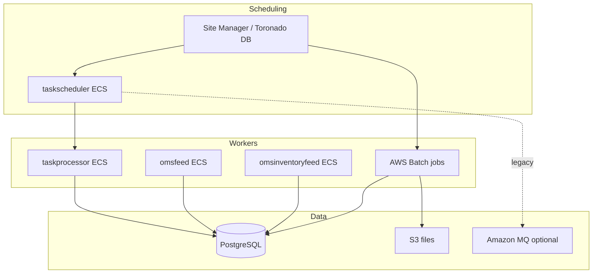

# Task engine, feeds, and export pipeline

**Audience:** Developers moving off **Windows scheduled tasks** and **RabbitMQ/ODX** flows; ops debugging feeds.  
**Prerequisites:** [00-onboarding.md](./00-onboarding.md).

---

## What this area does

OMS runs a lot of **background work**:

- **Tasks** — cancel lines, exports, imports, routing fixes (historically “ODX handlers” and Toronado steps).  
- **Feeds** — push inventory or order data to partners, marketplaces, or files.

Some of this still runs on **ECS** (`taskscheduler`, `taskprocessor`, `omsfeed`, `omsinventoryfeed`). **New bulk work** for Service Manager migration runs on **AWS Batch** ([01-batch.md](./01-batch.md)) instead of Windows services.

---

## Three eras (simple mental model)

| Era | Transport | Where documented |
|-----|-----------|------------------|
| **Legacy Windows** | Service Manager timer → EXE on server | `ShopVisible.JobManager.*` in `RepoSuite/oms` |
| **Legacy AWS ECS + MQ** | RabbitMQ queues, ODX consumers | Being retired for inventory/export ([01-batch.md](./01-batch.md)) |
| **Target AWS** | Batch Fargate + scheduler API | [01-batch.md](./01-batch.md), [07-batch-scheduler-api-ui.md](./07-batch-scheduler-api-ui.md) |

You will see **all three** in one environment during migration.

---

## Architecture

---

## Monorepo map — tasks (`RepoSuite/oms`)

| Folder | Role |
|--------|------|
| `ShopVisible.JobManager.JobManagerService` | Windows / service host for job manager |
| `ShopVisible.JobManager.JobProcessorService` | Processes scheduled work items |
| `ShopVisible.JobManager.Common` | Shared job manager types |
| `ShopVisible.Core.Scheduler` | Scheduling primitives |
| `ShopVisible.Core.Tasks` | Task implementations |
| `DCEOM.Toronado.Services` | Toronado integration |
| `DCEOM.Toronado.DataAccess` | Scheduler DB access |
| `ShopVisible.Core.ExportClasses` | Export generation (inventory feed lineage) |
| `ShopVisible.Core.FeedClasses` | Feed helpers |

**Toronado** stores **job steps**, export XML, and **`lastsynced`** — Batch Inventory Feed still updates `jobstep.lastsynced` when configured ([01-batch.md](./01-batch.md)).

---

## Monorepo map — feeds

| Folder | Role |
|--------|------|
| `ShopVisible.Core.ExportClasses` | Core export logic (Phase 1 legacy) |
| `ShopVisible.Core.FeedClasses` | Feed utilities |
| `ShopVisible.Feeds.Amazon` | Amazon feed integrations |
| `Shopvisible.Core.AmazonS3` | S3 interactions (legacy patterns) |

**Batch Inventory Feed** reimplements ODX Phase 2 **in-process** in `oms-aws-service-manager-batch` — see `docs/ARCHITECTURE.md` in batch repo.

---

## Infrastructure — ECS (Harness `oms15-ECS.yaml`)

| Harness stage | Terraform folder | Service |
|---------------|------------------|---------|
| `taskscheduler_deploy` | `06-taskscheduler` | Task scheduling API/worker |
| `taskprocessor_deploy` | `09-taskprocessor` | Executes tasks |
| `omsfeed_deploy` | `07-omsfeed` | Order-related feed worker |
| `omsinventoryfeed_deploy` | `08-omsinventoryfeed` | Inventory feed worker |

Each stack has its own **terraform.tfstate** under `{space}/{environment}/applications/ecs-service/{name}/`.

SSM prefixes in parameter store: `…/taskscheduler/…`, facades/feeds have dedicated prefixes — see [10-platform-data-delivery.md](./10-platform-data-delivery.md).

---

## Mapping: ODX handler → Batch job

| ODX / legacy concept | AWS Batch job |
|---------------------|---------------|
| Inventory export via queue | **Inventory Feed** |
| Export order items handler | **Export Order Items** |
| Cancel items handler | **Cancel Items** |
| Reset for reroute | **Reset Items for Reroute** |
| Update item status | **Update Item Status** |

Task-style jobs use **generic TASK envelope** JSON ([01-batch.md](./01-batch.md)). Inventory uses **EXPORT / PRODUCTINVENTORY**.

---

## Feeds still on ECS vs Batch

| Workload | Typical runtime today |
|----------|------------------------|
| Scheduled **bulk** Service Manager jobs (migration list) | **Batch** (target) |
| Continuous / message-driven feed listener | **omsfeed** / **omsinventoryfeed** ECS (until retired) |
| Task processor backlog | **taskprocessor** ECS |

**Do not assume** one feed path — check environment deploy manifest and feature flags.

---

## Database and scripts

| Path | Use |
|------|-----|
| `SQLChangeScripts/{version}/` | Incremental OMS DB changes |
| `DBMigrationScript/` | Broader migration tooling |
| Batch stage **C/D** | `oms_batch` catalog in Postgres ([02-terraform.md](./02-terraform.md)) |

---

## Operations guide

| Symptom | Check |
|---------|--------|
| Tasks stuck queued | taskscheduler logs; `taskprocessor` scale/desired count |
| Feed duplicate files | Export Batch `taskId` + `OMSFeedsExportedItemRecord` ([01-batch.md](./01-batch.md)) |
| Inventory not updating `lastsynced` | Submit JSON `settings.JobStepId`; exit code 0 with zero errors |
| MQ backlog growing | Legacy path — plan migration to Batch or fix consumer ECS |

---

## Pitfalls

1. **Export Order Items `taskId`** must be scheduler GUID — not Batch job id.  
2. **Empty filters** on export can mean “everything” up to max records — dangerous in prod.  
3. **RabbitMQ** is gone from **batch repo**, not necessarily from whole estate.

---

## Next reading

- [01-batch.md](./01-batch.md)  
- [07-batch-scheduler-api-ui.md](./07-batch-scheduler-api-ui.md)  
- [04-deep-repo-scan.md](./04-deep-repo-scan.md)  
