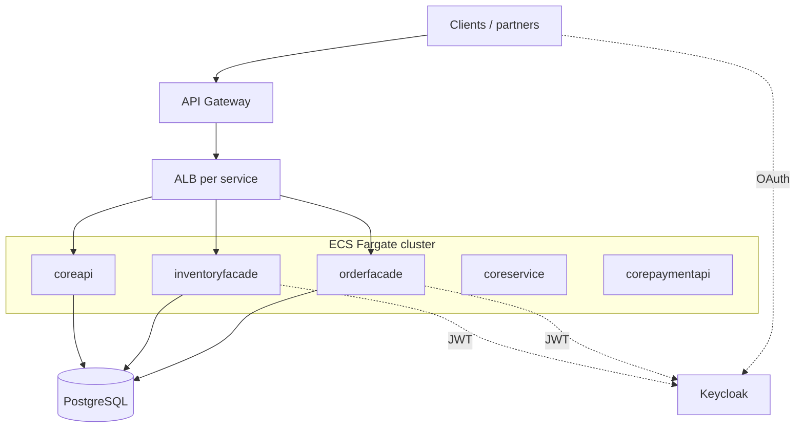

# Facades, core services, identity, and edge

**Audience:** API integrators, microservice owners, security reviewers.  
**Prerequisites:** [00-onboarding.md](./00-onboarding.md), [06-site-manager-shoplogic.md](./06-site-manager-shoplogic.md).

---

## What this area does

Not everything in OMS is Site Manager. **Facades** and **core services** expose **HTTP APIs** (often behind **API Gateway** or **ALB**) for orders, inventory, payments, taxation, and configuration rules. **Keycloak** and **Cognito** handle identity; **Route53** publishes hostnames.

This page maps **Terraform ECS stacks** to roles. **Application source** for many images is a **separate build** from the `RepoSuite/oms` monorepo root — you identify behavior by **container name + ECR repo** in Harness variables.

---

## ECR `imagePath` values (`oms15-ECS.yaml`)

Harness **deploy** stages pull these ECR repository names (build account → tag in workload account). They are the authoritative link between **running ECS** and **Bitbucket build repos** — grep Bitbucket for the repo that publishes each image.

| Deploy stage | `imagePath` (ECR repo name) | Terraform folder |
|--------------|----------------------------|------------------|
| printing / eFormz adj | `eom-service-printing-eformz` | (adjunct; not in `oms15` main list) |
| online payment | `scp-service-online-payment` | payment-related stacks |
| `taskscheduler_deploy` | `eom_scheduler_api` | `06-taskscheduler` |
| `omsfeed_deploy` | `odx_omsfeeds_export` | `07-omsfeed` |
| `omsinventoryfeed_deploy` | `odx_omsinventory_export` | `08-omsinventoryfeed` |
| `taskprocessor_deploy` | `odx_taskprocessor` | `09-taskprocessor` |
| `orderfacade_deploy` | `eom-service-order-facade` | `10-orderfacade` |
| `inventoryfacade_deploy` | `eom_service_inventory_api` | `11-inventoryfacade` |

**Scheduler (Batch migration):** `oms-aws-job-scheduler` — separate pipeline (`22-servicemanagerscheduler`), not in `oms15-ECS.yaml`. See [18-scheduler-api.md](./18-scheduler-api.md).

---

## ECS service catalog (from Harness `oms15-ECS.yaml`)

| Deploy stage | Terraform folder | Typical purpose |
|--------------|------------------|-----------------|
| `keycloak_deploy` | `03-keycloak` | Identity provider realms |
| `minisoft_deploy` | `04-minisoft` | Site Manager ([06](./06-site-manager-shoplogic.md)) |
| `extensibility_deploy` | `05-extensibility` | Customization / extension API |
| `taskscheduler_deploy` | `06-taskscheduler` | Task scheduling ([08](./08-task-engine-feeds.md)) |
| `omsfeed_deploy` | `07-omsfeed` | Order feeds |
| `omsinventoryfeed_deploy` | `08-omsinventoryfeed` | Inventory feeds |
| `taskprocessor_deploy` | `09-taskprocessor` | Task execution |
| `orderfacade_deploy` | `10-orderfacade` | Order domain HTTP API |
| `inventoryfacade_deploy` | `11-inventoryfacade` | Inventory domain HTTP API |

**Additional ECS folders** (same `01-aws-ecs-service/` pattern; often separate Harness pipelines or later stages):

| Folder | Purpose |
|--------|---------|
| `15-configrulemanager` | Configuration rules |
| `16-coreapi` | Core HTTP API |
| `17-coreservice` | Core backend service |
| `18-corepaymentapi` | Payments API |
| `19-corekekservice` | Key encryption (KEK) |
| `20-omstaxationfacade` | Taxation facade |
| `21-omstaxation` | Taxation engine |
| `22-servicemanagerscheduler` | Batch scheduler API ([07](./07-batch-scheduler-api-ui.md)) |
| `01-currencyexchange` | Currency exchange adjunct |
| `02-efs-fileexplorer` | File browser on EFS |

---

## Logical architecture

---

## SSM prefix cheat sheet

From `01-infrastructure/01-parameterstore/3-local-values.tf`:

| Prefix variable | Service family |
|-----------------|----------------|
| `orderfacadeprefix` | Order facade endpoints/config |
| `inventoryfacadeprefix` | Inventory facade |
| `apiprefix` / `servicesprefix` | Core APIs |
| `paymentapiprefix` | Payments |
| `kekprefix` | KEK service |
| `taxationprefix` / `taxationfacadeprefix` | Tax |
| `extensibilityprefix` | Extensibility |
| `keycloakprefix` | Keycloak |
| `configrulemanagerprefix` | Config rules |

Pattern: `/{owners}/{space}/{environment}/{service}/…`

---

## Identity

| Component | Stack | Notes |
|-----------|-------|-------|
| **Keycloak** | `03-keycloak` | Issuer URL used by scheduler JWT validation |
| **Cognito** | `05-aws-cognito` | User pools; may relate to admin login depending on `sitemanager_authentication_mode` |
| **JWT in APIs** | Per-service task defs | Scheduler example: `JwtValidation__ValidIssuer` = Keycloak realm |

Site Manager login path: [06-site-manager-shoplogic.md](./06-site-manager-shoplogic.md).

---

## Edge and routing

| Stack | Role |
|-------|------|
| `10-aws-api-gateway` | Central API Gateway resources |
| `12-core-route53` | DNS; reads `sitemanager_endpoint` and similar SSM |
| `04-oms-providers/common/aws-api-gateway` | Shared modules |

Facades often expose **CNAME** variables in Harness (`order_facade_cname`, `inventory_facade_cname`).

---

## Application source hints (`RepoSuite/oms`)

| Concern | Monorepo pointers |
|---------|-------------------|
| Core business | `DCEOM.Services`, `DCEOM.Product.Application`, `ShopVisible.API` |
| Plugins (payments, etc.) | `DCEOM.Plugins` (WorldPay, Adyen, …) |
| Data | `DCEOM.DataAccess`, `DCEOM.Models` |
| Auth components | `EOM.Component.Authentication` |

**Facades** may be built from **other Bitbucket repositories** — confirm with ECR image name in your environment’s `config.tfvars` / Harness output.

---

## How facades differ from Site Manager

| | Site Manager (minisoft) | Facade |
|---|-------------------------|--------|
| User | Human operators | Systems / integrations |
| Protocol | HTML + some JSON APIs | Primarily JSON/HTTP |
| Auth | Forms / Keycloak session | Bearer tokens, API keys |
| Deploy | `04-minisoft` | `10-orderfacade`, `11-inventoryfacade`, … |

---

## On-call quick reference

| Alert on… | First log group |
|-----------|-----------------|
| orderfacade | ECS service `orderfacade` CloudWatch |
| inventoryfacade | ECS `inventoryfacade` |
| coreapi | ECS `coreapi` |
| 502 at edge | API Gateway + target group health |
| Auth failures | Keycloak + calling service JWT settings |

---

## Pitfalls

1. **Calling facade URL from browser** without token — different from backadmin session cookies.  
2. **Multiple API gateways** — check whether client should use `apiprefix` SSM or facade CNAME.  
3. **Image ≠ monorepo folder** — always trace **ECR repository name** in Terraform back to build pipeline.

---

## Next reading

- [34-functional-order-services-deep-scan.md](./34-functional-order-services-deep-scan.md) — ASMX vs facade vs `IOrderService`  
- [06-site-manager-shoplogic.md](./06-site-manager-shoplogic.md)  
- [10-platform-data-delivery.md](./10-platform-data-delivery.md)  
- [08-task-engine-feeds.md](./08-task-engine-feeds.md)  
