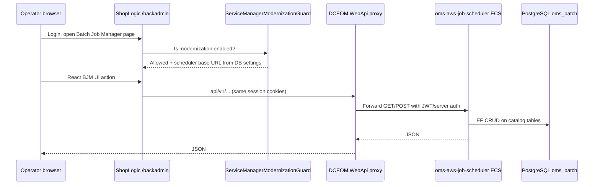
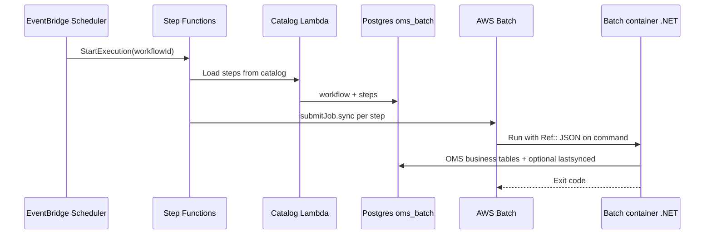

# Functional flows — cross-repo (how work actually runs)

**Audience:** Anyone tracing a feature across `oms`, scheduler, Batch, and Terraform.  
**Prerequisites:** [00-onboarding.md](./00-onboarding.md).

---

## Flow 1 — Operator opens Batch Job Manager (happy path)

**Functional rules:**

- **`ServiceManagerModernizationGuard`** (`DCEOM.Infrastructure`) — if disabled, proxy returns **403**; admins are not exempt ([`BatchSchedulerProxyController`](RepoSuite/oms/DCEOM.WebApi/BatchSchedulerProxyController.cs)).
- Scheduler URL from **`InfrastructureSetting`** / SSM-backed settings (`APIGatewayBatchSchedulerURL`) — see SQL in [28-functional-oms-monorepo.md](./28-functional-oms-monorepo.md).
- **No direct browser → scheduler** in production; always **ShopLogic → WebApi → scheduler**.

---

## Flow 2 — Scheduled job fires → container runs

Details: [17-workflows-and-step-functions.md](./17-workflows-and-step-functions.md), [30-functional-scheduler-platform.md](./30-functional-scheduler-platform.md).

**When EventBridge is disabled on scheduler ECS:** API still writes **Postgres**; AWS schedules are **NoOp** — UI shows jobs that do not fire until [runbook deploy](RepoSuite/oms-aws-service-manager-batch/docs/batch-job-manager-deployment-runbook.md).

---

## Flow 3 — Inventory feed (business outcome)

| Step | What happens |
|------|----------------|
| 1 | Operator or schedule defines **export XML** + **job step id** in Toronado/BJM catalog |
| 2 | SubmitJob JSON carries `configType: EXPORT`, `operation: PRODUCTINVENTORY` |
| 3 | Container resolves suppliers from OMS SQL (legacy ExportClasses patterns) |
| 4 | **Demandware XML** built per supplier, uploaded to **S3** |
| 5 | **`jobstep.lastsynced`** updated on success (exit 0, error count 0) |

Legacy path (ECS/MQ) still possible in same DB; Batch path has **no RabbitMQ** ([29-functional-batch-jobs.md](./29-functional-batch-jobs.md)).

---

## Flow 4 — Bulk cancel / update / reroute / export orders

| Job | User intent | EOM? | Notable side effect |
|-----|-------------|------|---------------------|
| Cancel items | Mass cancel lines matching filters | Yes | Optional **SES** email |
| Update item status | Mass status change | Yes | Max runtime guard |
| Reset for reroute | Undo routing state for reroute | Yes | Per-order error → exit **7** |
| Export order items | Partner order export file | Yes | S3 file + order notes; **taskId** de-dupe |

All use **generic TASK/EXPORT JSON envelope** ([01-batch.md](./01-batch.md)).

---

## Flow 5 — Greenfield Service Manager Batch in an environment

| Order | Actor | Action |
|-------|--------|--------|
| 1 | Platform | Harness **A → C** (Batch platform + catalog CE/JQ) |
| 2 | Platform | SQL baseline `oms_batch` + SM SQL scripts |
| 3 | App | Deploy **scheduler ECS** (`22-servicemanagerscheduler`) |
| 4 | Platform | Step Functions + per-job **B → D** |
| 5 | App | Publish **batch** + **scheduler** images to ECR |
| 6 | QA | Enable modernization guard + BJM nav SQL |
| 7 | QA | Smoke: create CE/JQ/JD in UI → schedule → one run |

Full steps: batch repo runbook → [16-operations-runbooks.md](./16-operations-runbooks.md).

---

## Flow 6 — Site Manager login (QA)

| Step | System |
|------|--------|
| 1 | Browser → `…/backadmin/login.aspx` |
| 2 | Auth per env (Cognito / forms / Keycloak mode via SSM) |
| 3 | Session drives all `.aspx` + embedded React bundles |

[03-qa-environments.md](./03-qa-environments.md).

---

## Related

- [28-functional-oms-monorepo.md](./28-functional-oms-monorepo.md)  
- [29-functional-batch-jobs.md](./29-functional-batch-jobs.md)  
- [30-functional-scheduler-platform.md](./30-functional-scheduler-platform.md)  
- [31-functional-infrastructure-platform.md](./31-functional-infrastructure-platform.md)
