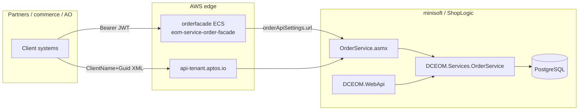

# Order services — deep scan (monorepo + facades + Confluence)

**Audience:** Integrators, commerce QA, microservice owners, anyone asking “where is Order Service?”  
**Sources:** `RepoSuite/oms` (Nov 2026), `oms-infrastructure` Harness `oms15-ECS.yaml`, Confluence **DC** + **OMS20** (live pull).  
**Related:** [09-facades-core-edge.md](./09-facades-core-edge.md), [33-functional-commerce-and-apis.md](./33-functional-commerce-and-apis.md), [08-task-engine-feeds.md](./08-task-engine-feeds.md).

---

## 1. The naming trap — four different “order services”

People say **Order Service** and mean different layers. Use this table before debugging.

| Name people use | What it actually is | Protocol / auth | Source in repo? |
|-------------------|---------------------|-----------------|------------------|
| **`OrderService.asmx`** | Legacy **ShopVisible public integration API** (XML SOAP/HTTP) | `ClientName` + `Guid`, site connection string | **Yes** — `EOM.ShopLogicApi/OrderService.asmx.cs` |
| **`DCEOM.Services.OrderService`** | In-process **domain service** (`IOrderService`) | Unity DI inside minisoft / Toronado shell | **Yes** — `DCEOM.Services/OrderService.cs` |
| **`eom-service-order-facade`** | **Modern REST wrapper** in front of ASMX (ECS/K8s) | Keycloak JWT + audience `eom-order-facade` | **No** — separate ECR image; config in Terraform `10-orderfacade` |
| **`OrdersController` / refund / RMA APIs** | **Site Manager session JSON** for operators | Cookie session (`ClientSideAuthorization`) | **Yes** — `DCEOM.WebApi` |

**Confluence (canonical facade deploy):** [Order Facade Api](https://aptos.atlassian.net/wiki/spaces/DC/pages/139697185/Order+Facade+Api) — documents `orderApiSettings.url` pointing at `https://api-…/orderservice.asmx`, ECR `eom-service-order-facade`, JWT realm settings.

**Strategy note (OMS20, 2026):** [Inventory facade meeting summary](https://aptos.atlassian.net/wiki/spaces/OMS20/pages/1780580402) — inventory facade retirement is in flight; **order facade is explicitly “later”** in that roadmap.

---

## 2. ECS / ODX services that touch orders (Harness `oms15-ECS.yaml`)

These are the **order-adjacent containers** deployed with the main OMS ECS pipeline (not the full list of all Terraform ECS folders).

| Deploy stage | ECR `imagePath` | Terraform folder | Order role |
|--------------|-----------------|------------------|------------|
| `orderfacade_deploy` | `eom-service-order-facade` | `10-orderfacade` | External REST order API; proxies to ASMX |
| `inventoryfacade_deploy` | `eom_service_inventory_api` | `11-inventoryfacade` | ATP / store stock (often **before** order create) |
| `omsfeed_deploy` | `odx_omsfeeds_export` | `07-omsfeed` | Order **export** feeds to partners |
| `omsinventoryfeed_deploy` | `odx_omsinventory_export` | `08-omsinventoryfeed` | Inventory feed (reservation context) |
| `taskprocessor_deploy` | `odx_taskprocessor` | `09-taskprocessor` | Runs Toronado / scheduled **order jobs** |
| `taskscheduler_deploy` | `eom_scheduler_api` | `06-taskscheduler` | Legacy scheduler API (task catalog) |
| — | `scp-service-online-payment` | (payment stacks) | Capture/auth adjacent to order payment |
| — | `eom-service-printing-eformz` | adjunct | Labels/docs (ship confirm path) |

**Additional Terraform ECS roots** (separate pipelines possible): `16-coreapi`, `17-coreservice`, `18-corepaymentapi`, `20-omstaxationfacade`, `21-omstaxation`, `22-servicemanagerscheduler` — see [15-infrastructure-stack-index.md](./15-infrastructure-stack-index.md).

**SSM:** `/{owners}/{space}/{env}/orderfacade/endpoint` — used by Terraform for ALB/CNAME ([09](./09-facades-core-edge.md)).

---

## 3. `OrderService.asmx` — public integration surface (33 WebMethods)

**Physical path (typical):** `https://api-{tenant}.aptos.io/OrderService.asmx/{MethodName}`  
**Implementation:** ~3,900 lines — delegates to legacy `*Logic` classes + `SvcLocator.GetInstance<IOrderService>()` and friends.  
**Confluence API wiki hub:** PDFs attached under DC page tree rooted at [Order API docs / usage pages](https://aptos.atlassian.net/wiki/spaces/DC/pages/311558145) (migrated ShopVisible API Wiki).

| Method | Primary intent | Happy path | Typical failures | Expect |
|--------|----------------|------------|------------------|--------|
| `ConfirmShippedOrder` | ASN / ship confirm from WMS or partner | Valid ASN XML, auth OK | Bad XML, auth in `authentication_error`, payment collect flags invalid | XML `ResponseDO`; may charge + email per bool flags |
| `CreditOrderSimple` / `CreditOrderDetailed` | Post credits | Valid credit XML | Order not found, payment rules | XML response; errors in `ResponseHasErrors` |
| `GetOrderByOrderNumber` | Single order read | Known order number | Wrong tenant Guid, not found | Order XML |
| `GetOrderHeaders` | Header slice | Valid filters in processing options | Auth, bad processing string | Filtered header XML |
| `GetOrdersByStatus` | Poll by status | Status exists | Max records, empty set | List XML |
| `GetOrdersToExport` | Supplier export pull | Supplier + status match | No rows, buyers remorse window | Export XML |
| `ResetOrdersForExportAdvanced` | Re-queue export | Prior `GetOrdersToExportAdvanced` use | Order state not exportable | Success/fail XML |
| `GetOrderCredits` | Unprocessed credits | Credits pending | None pending | Credit list XML |
| `GetOrdersByDateTimeRange` | Time-window read | Range ≤ 1 hour | Range too wide | Orders XML |
| `GetChangedOrdersByDateRangeAdvanced` | Delta sync | Valid datetime range | Clock/auth issues | Changed orders XML |
| `SetOrderStatus` / `Advanced` / `ByExternalIDs` | Header status moves | Valid status id / external id | Illegal transition, fraud holds | XML response |
| `SetItemStatus` / `Advanced` / `ByExternalIDs` | Line status moves | Valid item ids | Supplier mismatch | XML response |
| `GetOrdersByCustomerEmail` / `Name` | CRM-style lookup | Customer exists | PII mismatch, too many rows | Orders XML |
| `ProcessPayment` | Capture/auth from integration | Order + tender XML valid | Processor decline, already captured | Payment result XML |
| `SubmitNewOrdersWithPayment` | Create order + pay | Valid order XML, inventory | Fraud, tax, payment, duplicate external id | Success XML + order number or error collection |
| `SubmitNewOrdersWithPaymentAdvanced` | Same + processing options | As above | Invalid processing flags | Richer response section |
| `SubmitInStoreReturns` | Store return intake | Return XML | Item not returnable | Return confirmation XML |
| `GetOrderNotesByOrderNumber` | Notes read | **Order number** (not id) | Wrong identifier type | Notes XML |
| `GetOrderNotesByDateRange` | Notes poll (7-day) | Valid range | Empty | Notes XML |
| `SubmitOrderNote` / `SubmitOrderNoteSOAP` | Add note | Order exists | Auth | OK / SOAP `ResponseDO` |
| `GetOrderDetailsByOrderNumber` | Deep read | Order number | Not found | Detail XML |
| `GetOrderStatistics` | Store fulfillment stats | Store processing options | Bad store id | Statistics XML |
| `UpdateItemStatus` | Batch item updates | Item list valid | Status rules | Result XML |
| `SubmitReconciliationData` | Payment reconciliation | Transaction collection | Duplicate seq | String status |
| `GetAmountToCapture` | Pre-capture amount | Part numbers/qty | Split ship partial | Amount XML |
| `UpdateAdditionalOrderInfo` | Item/order extended fields | Valid additional info XML | Schema mismatch | Update result |

**Cross-cutting ASMX behavior**

- **Auth:** `BaseService.GetConnectionString` — failures can surface as `HttpContext.Items["authentication_error"]` in the XML body (not always HTTP 401).
- **Format:** Almost all methods return **`XmlDocument`**; integrations must parse `ResponseHasErrors`, `ResponseCode`, `ResponseDescription`.
- **Payment path:** Used by internal tools (`Support.PaymentCapture` → `ProcessPayment`, `GetOrderByOrderNumber`).

---

## 4. `IOrderService` (`DCEOM.Services.OrderService`) — domain layer

Registered in `ShopVisible.Core.Shell/Bootstrapper.cs` as `IOrderService` → `OrderService` (also Toronado bootstrap duplicate registration).

**Responsibilities (interface summary):**

| Area | Methods (representative) | Called from |
|------|--------------------------|-------------|
| **Export / ODX** | `GetOrdersToExportCollection`, `GetCompleteOrdersToExport*`, `GetOrdersToExportByItemSupplierID` | Export jobs, feeds, ASMX export methods |
| **Read** | `GetOrderById`, `GetOrder`, `GetOrderByCustomer`, `GetOrderByItem` | Site Manager pages, feeds, ASMX |
| **Status** | `UpdateOrderStatus`, `CancelOrder` | Payment callbacks, tasks, admin |
| **Insert id generation** | `GetOrderIDandNumberForInsert` | Marketplace feeds (Amazon, Shop.com, …) |
| **Notes / stats** | `GetOrderNotesByOrderID`, `GetOrderStatistics` | APIs + reporting |
| **Reconciliation** | `SubmitReconciliationData` | Payment processors |

**Co-located order-related domain services** (`DCEOM.Services/`, same DI graph):

| Service | Role |
|---------|------|
| `RefundOrderService` (+ partials Adyen/Aurus/PayPal/…) | Credits, batch settlement, multi-tender |
| `CreditOrderService` | Order-level credit totals |
| `ReshipOrderService` | Reship flows |
| `OrderItemService` | Line-level operations |
| `OrderAuthService` | Authorization records |
| `OrderShippingService` / `OrderPackageService` | Shipments |
| `OrderTaxCalculationService` / `OrderSummaryTaxService` | Tax (pairs with `TaxationServiceController`) |
| `OrderRouterService` / `OrderRouterFulfillmentRuleService` | In-app routing rules |
| `OMSFeedsOrderService` / `OdxOmsFeedsOrderService` | Feed-specific order shaping |
| `OrderGiftCardService` | GC capture pending |
| `OrderVolumeService` | Analytics |

**Expectation:** UI and `DCEOM.WebApi` should prefer these services over raw SQL; ASMX often uses older `*Logic` classes but increasingly calls the same repositories.

---

## 5. Operator JSON APIs (`DCEOM.WebApi`) — order slice

Not a replacement for `OrderService.asmx`. Session cookie auth. Full scenario tables: [33-functional-commerce-and-apis.md](./33-functional-commerce-and-apis.md).

| Controller | Order scenarios |
|------------|-----------------|
| `OrdersController` | Item status summary, salesperson update, summary tax, tax calculation |
| `RefundOrderController` | Refund context + submit |
| `RequestRmaController` | RMA preview/commit/fees |
| `ManualAuthController` | Manual authorization commit |
| `ItemFulfillmentController` | Fulfill line items |
| `TaxationServiceController` | Avalara-style reads/recalc |
| `OrderCurrencyController` | Display currency conversion |
| `OrderAuthController` | Create order auth row |
| `OdxFeedMonitorController` | Feed backlog, stuck orders, queue by order id |

---

## 6. Toronado / batch jobs (background “order services”)

Documented in **OMS20** (“Toro Job” series). These run via **task processor** / Service Manager / AWS Batch modernization — not HTTP.

| Confluence page | Source file (monorepo) | Purpose |
|-----------------|------------------------|---------|
| [Toro Job - Order Routing](https://aptos.atlassian.net/wiki/spaces/OMS20/pages/921731162) | `EpicorOrderRouting.cs` | Assign fulfilment supplier to unrouted items |
| [Toro Job - Order Router](https://aptos.atlassian.net/wiki/spaces/OMS20/pages/1109393424) | `OrderRouter.cs` | Router variant / rules |
| [Toro Job - Orders Out](https://aptos.atlassian.net/wiki/spaces/OMS20/pages/920551485) | `EpicorOrdersOut.cs` | Export order payload to Epicor/EDA |
| [Toro Job - Inventory Reserve / Unreserve](https://aptos.atlassian.net/wiki/spaces/OMS20/pages/907771927) | `EpicorInventoryReserve.cs` | Hold/release stock for order workflow |

**Failure patterns (OMS20 whiteboards):** concurrent export runs reading the same pending order → duplicate fulfilment messages (see OMS20 whiteboards on duplicate export).

---

## 7. Routing microservice (separate from monolith router)

| Confluence | Service name | Notes |
|------------|--------------|-------|
| [The Routing Service](https://aptos.atlassian.net/wiki/spaces/DC/pages/139691202) | `eom-service-routing` | Delivery profiles, supplier selection |
| [Routing Service Flows](https://aptos.atlassian.net/wiki/spaces/DC/pages/139691119) | — | ATP → Routing async messages |
| [Routing Service RestAPIs](https://aptos.atlassian.net/wiki/spaces/DC/pages/139696484) | — | CRUD delivery profiles |

Monolith also has `OrderRouterService` / export `OrderRouter.cs` — distinguish **ECS routing API** vs **Toro jobs**.

---

## 8. Communication diagrams (Confluence DC)

| Page | Link |
|------|------|
| Communication hub (draw.io) | [Communication Between Services](https://aptos.atlassian.net/wiki/spaces/DC/pages/139696489) |
| Detail diagram | Attachments / child diagrams under same tree |
| Service network | Aptos Services Network Diagram (DC) |

Use these when tracing **which container calls which** for a tenant (legacy K8s + modern ECS).

---

## 9. QA / integration cheat sheet

| Goal | Use | Auth |
|------|-----|------|
| Create web order from storefront | `SubmitNewOrdersWithPaymentAdvanced` | ASMX Guid |
| AO / modern REST client | Order facade URL (SSM `orderfacade/endpoint`) | Keycloak bearer |
| Operator refund ship credit | Site Manager + `RefundOrderController` | Session |
| Partner ship confirm | `ConfirmShippedOrder` | ASMX Guid |
| Poll exports | `GetOrdersToExportAdvanced` + job processor | ASMX Guid |
| Debug feed stuck order | `OdxFeedMonitorController` + OMS20 Toro docs | Session |

**Release compatibility:** DC release pages (e.g. `OMS 2026.2`) list **Services** vs **Site Manager** vs **Toronado** version matrix — check before cross-environment API tests.

---

## 10. Confluence index (order-specific)

| Space | Page | Why read it |
|-------|------|-------------|
| DC | [Order Facade Api](https://aptos.atlassian.net/wiki/spaces/DC/pages/139697185) | Helm/values, `orderApiSettings`, JWT |
| DC | [Inventory Facade Api](https://aptos.atlassian.net/wiki/spaces/DC/pages/139697425) | Sister facade pattern |
| DC | [OMSEOM - ODX order facade and inventory facade deploy](https://aptos.atlassian.net/wiki/spaces/DC/pages/139692221) | Legacy K8s deploy template |
| DC | [ShopVisible API Wiki PDFs](https://aptos.atlassian.net/wiki/spaces/DC/pages/311558145) | Per-method integration PDFs |
| DC | [OMS Architectural Design Signoffs](https://aptos.atlassian.net/wiki/spaces/DC/pages/740753441) | Signoff registry (growing) |
| OMS20 | [OMS 2.0 Home](https://aptos.atlassian.net/wiki/spaces/OMS20/overview) | Onboarding + Toro catalog |
| OMS20 | Toro Job pages (§6) | Job behavior, failure modes |
| OMS20 | [DCOMS-28527 Service Manager Modernization](https://aptos.atlassian.net/wiki/spaces/OMS20/pages/1248460802) | Batch migration context |

---

## 11. Repo paths quick reference

| Artifact | Path |
|----------|------|
| ASMX | `RepoSuite/oms/EOM.ShopLogicApi/OrderService.asmx.cs` |
| Domain | `RepoSuite/oms/DCEOM.Services/OrderService.cs` |
| Interface | `RepoSuite/oms/DCEOM.Interfaces/Services/IOrderService.cs` |
| DI | `RepoSuite/oms/ShopVisible.Core.Shell/Bootstrapper.cs` |
| Operator API | `RepoSuite/oms/DCEOM.WebApi/OrdersController.cs` (+ refund/RMA/tax) |
| Facade TF | `RepoSuite/oms-infrastructure/03-application/01-aws-ecs-service/10-orderfacade/` |
| Harness ECS | `RepoSuite/oms-infrastructure/01-infrastructure/08-core/harness-pipeline-source/oms15-ECS.yaml` |

---

## 12. Gaps / follow-ups

1. **Order facade OpenAPI** — not in `oms` monorepo; trace Bitbucket repo that builds `eom-service-order-facade`.  
2. **Core API / Core Service** — Terraform folders exist; image names not in `oms15-ECS.yaml` snippet — check tenant-specific Harness pipelines ([20-harness-pipelines.md](./20-harness-pipelines.md)).  
3. **Facade method-level map** — REST routes ≠ ASMX 1:1; need facade repo or Postman collections from DC attachments.  
4. **Confluence sync** — this file is workspace source of truth; link out to DC/OMS20 when disputing behavior.

**Next reading:** [33-functional-commerce-and-apis.md](./33-functional-commerce-and-apis.md) for Site Manager + WebApi scenario packs.
